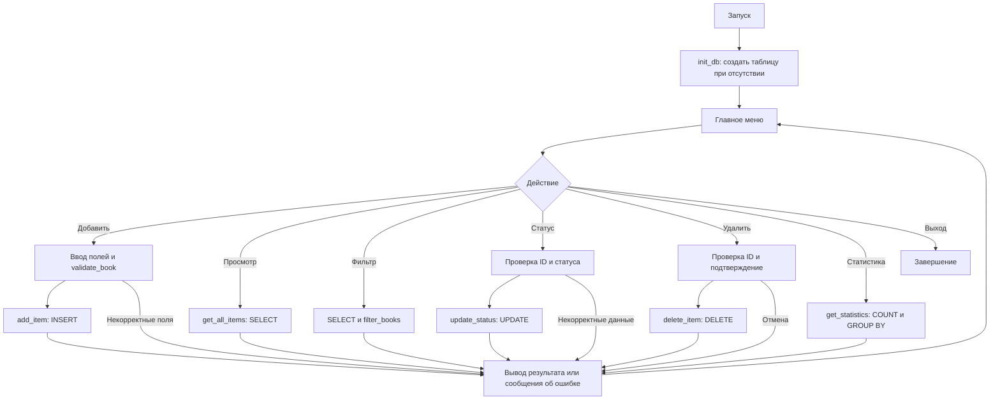

# Учёт прочитанных книг

Экзаменационный проект: консольная домашняя библиотека на Python с хранением данных в SQLite.

## Автор

Дмитрий Терещук, группа ПРЗ-23, 2026.
Специальность: 09.02.07 Информационные системы и программирование

## Возможности

- Добавление книги: название, автор, жанр, статус.
- Статусы: «в планах», «читаю», «прочитано».
- Просмотр всех книг и фильтрация по статусу или жанру.
- Изменение статуса по ID.
- Удаление книги по ID с подтверждением.
- Статистика: количество прочитанных книг и количество книг каждого жанра.
- Сохранение данных между запусками.
- Проверка пустых полей, ID, статусов и неверных пунктов меню.

## Требования

Python 3.10+, Linux (в том числе РЕД ОС), Bash.
Для установки pytest нужен доступ к индексу пакетов.
SQLite доступен через стандартный модуль sqlite3; устанавливать его через pip не нужно.
Тестовая зависимость указана в requirements.txt.

## Структура

```text
books_tracker/
├── .gitignore
├── README.md
├── requirements.txt
├── main.py
├── logic.py
├── db.py
├── test_logic.py
├── test_db.py
├── install.sh
├── run.sh
├── test.sh
├── venv/          # создаётся при установке, игнорируется Git
└── project.db     # создаётся при установке/запуске, игнорируется Git
```

## Установка и запуск

Из папки проекта:

```bash
chmod +x install.sh run.sh test.sh
./install.sh
./run.sh
```

Ручной вариант:

```bash
python3 -m venv venv
source venv/bin/activate
python -m pip install -r requirements.txt
python main.py
```

База создаётся автоматически рядом с db.py, а не в произвольной текущей папке.
Повторная установка не очищает записи.

## Меню

1. Добавить книгу.
2. Показать все книги.
3. Фильтр по статусу.
4. Фильтр по жанру.
5. Изменить статус книги.
6. Удалить книгу по ID.
7. Статистика.
0. Выход.

Жанры сохраняются в нижнем регистре. Фильтр жанра требует полного названия,
но не учитывает регистр и лишние пробелы. Статусы выбираются по номерам.
Можно добавлять несколько экземпляров одинаковой книги: каждый имеет собственный ID.
Статистика по жанрам включает все статусы, а число прочитанных — только «прочитано».

## Архитектура и функции

- main.py: ввод, меню, вывод и обработка ошибок.
- logic.py: validate_book, normalize_status, parse_book_id, filter_books, format_book.
- db.py: init_db, add_item, get_all_items, update_status, delete_item, get_statistics.
- Все операции SQL с пользовательскими значениями используют параметры.
- Соединения с базой закрываются после операций.

## Структура базы

Таблица books:

| Поле | Тип | Назначение |
|---|---|---|
| id | INTEGER PRIMARY KEY AUTOINCREMENT | Идентификатор книги |
| title | TEXT NOT NULL | Название |
| author | TEXT NOT NULL | Автор |
| genre | TEXT NOT NULL | Жанр |
| status | TEXT NOT NULL | Статус чтения из фиксированного списка |

Пустые текстовые поля запрещены; статус ограничен CHECK.

## Блок-схема



## Тестирование

```bash
./test.sh
```

Либо:

```bash
source venv/bin/activate
pytest -v
```

Проверки логики: нормализация, пустые поля, некорректные ID и статусы,
фильтры, отсутствие совпадений, форматирование.
Проверки базы: добавление, чтение, обновление, удаление, отсутствующие ID,
статистика, пустая база, повторная инициализация и безопасная передача SQL-подобного текста.
Тесты БД используют tmp_path и monkeypatch: пользовательская база не изменяется.
После успешного запуска pytest возвращает код 0.
Фактический результат тестирования проверяется запуском на целевой машине.

## Ручная проверка

1. Добавить книгу со статусом «читаю».
2. Показать список и запомнить ID.
3. Проверить фильтры по жанру и статусу.
4. Изменить статус на «прочитано» и открыть статистику.
5. Выйти и запустить снова: книга должна сохраниться.
6. Проверить неверный ID, пустое название и неизвестный пункт меню.
7. Удалить книгу по ID, подтвердить и убедиться, что она исчезла.

## Git и передача проекта

venv, project.db и кеши не включаются в Git.
Перед сдачей выполнить git status и git log --oneline.
Для проверки чистой копии клонировать репозиторий в другую папку,
выполнить ./install.sh, ./test.sh и ./run.sh.
